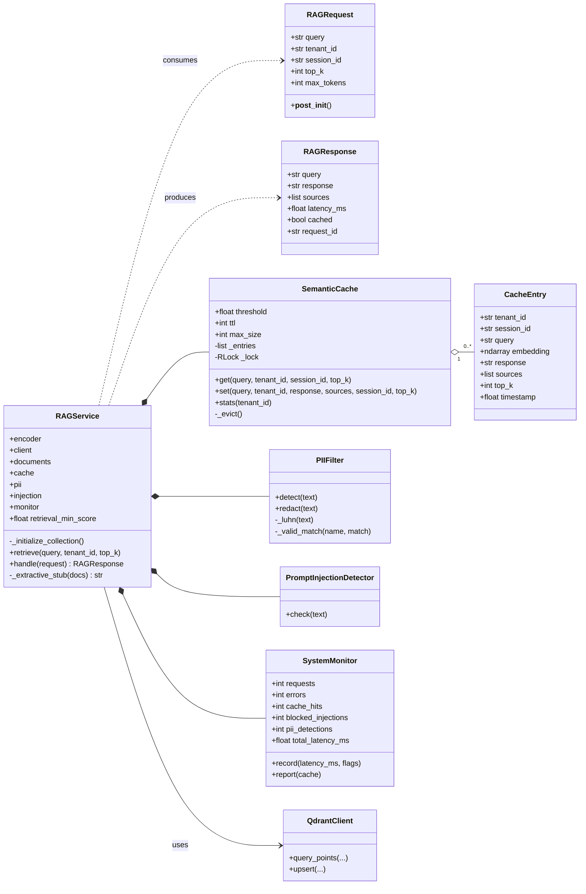
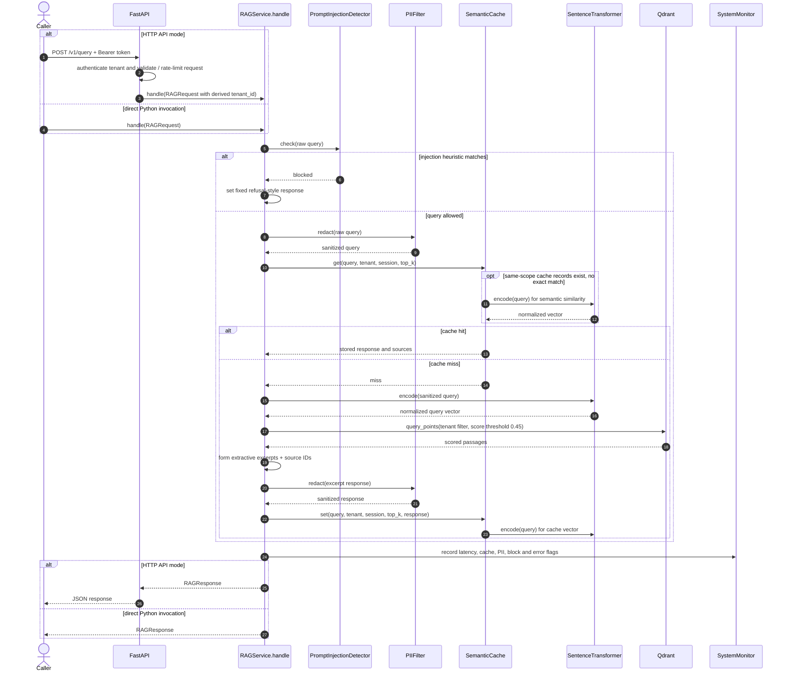

# Low-Level Design (LLD)

This design maps to **`RAG_Service_Corrected_2026_Diagnostics.py`**. Other Python variants share the same major classes; prefer the diagnostics variant for investigation.

## 1. UML-like class diagram

### Responsibilities

| Unit | Main responsibilities |
|---|---|
| `RAGRequest` | Validates nonempty query (≤ 4000 chars), tenant ID, `top_k` (1–20), `max_tokens` (1–2048); immutable dataclass |
| `RAGResponse` | Contains original query, excerpt response, sources, timing, cache flag, request ID |
| `RAGService` | Wires model, Qdrant, cache, guards and metrics; startup indexing; retrieval; response assembly |
| `PIIFilter` | Detects/replaces a limited set of regex PII patterns; Luhn check for candidate card numbers; IPv4 validation |
| `PromptInjectionDetector` | Checks fixed regex patterns, emits heuristic risk details |
| `SemanticCache` | In-process TTL cache, exact hits then cosine similarity; keyed on tenant, session and `top_k` |
| `CacheEntry` | Stores normalized query vector plus response and key metadata |
| `SystemMonitor` | Tracks request counters, latency and optional system RAM usage |
| `create_app` | Builds FastAPI app and per-tenant authentication dependencies |

## 2. Query processing sequence

### Decision tree / critical path

1. `handle()` starts a timer and random 12-character request ID.
2. `PromptInjectionDetector.check(request.query)` checks the **raw** query. Matched red flags lead to a fixed refusal-style string; no retrieval or cache update happens.
3. Otherwise `PIIFilter.redact()` sanitizes some input patterns and records a warning if PII was detected.
4. `SemanticCache.get(clean_query, tenant_id, session_id, top_k)` checks tenant/session/`top_k`-matched, unexpired records: exact query first, then cosine threshold `>= 0.98` for semantic similarity.
5. On miss, `retrieve()` encodes query and runs `QdrantClient.query_points(...)` with a hard `tenant_id` filter, `score_threshold=0.45`, and `limit=top_k`.
6. `_extractive_stub()` returns a no-match notice or bullet excerpts; output `PIIFilter.redact()` is applied to the newly constructed output.
7. `SemanticCache.set(...)` stores the sanitized response. Metrics are recorded in a `finally` block, including failures.
8. The returned response contains the **original** unsanitized query. This behavior is a privacy caveat, not a recommended design.

## 3. Cache algorithm (implementation-specific)

- In-memory `list[CacheEntry]` protected with `threading.RLock`.
- Deletes expired entries on cache operations using `time.monotonic()`.
- Exact matches avoid re-encoding at lookup; semantic lookup calculates an embedding if any same-scope entries exist.
- Cosine comparison uses `np.dot()` and relies on normalized embedding vectors.
- `set()` always encodes a query to store its vector, even when retrieval already encoded the same query (an optimization opportunity).
- At capacity (1000), removes the oldest remaining entry; this is **not a distributed/LRU cache**.

## 4. Failure semantics

- Invalid `RAGRequest` fields raise `ValueError` when constructed.
- Errors inside `RAGService.handle` are logged and re-raised; the monitor's error count still increases.
- Qdrant/model import and model-download errors surface during initialization of demo/API modes.
- `SystemMonitor.report()` uses an error-rate threshold to set a simple `healthy/degraded` status; that is not a readiness probe for all dependencies.

## 5. Unused data members

`max_tokens` and `SYSTEM_PROMPT` do **not** control any generation or token usage. They are placeholders for future generative RAG work. See [[Future-Roadmap]].
