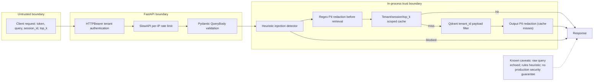

# Security and Limitations

**Educational proof of concept only.** This project has not received a comprehensive security review, adversarial test, load test or production deployment assessment.

## Security boundaries

## Security controls present

1. API mode uses `HTTPBearer`, maps a token to a tenant identity, and uses `secrets.compare_digest` when checking keys.
2. Query vector searches include a required Qdrant `tenant_id` payload filter; cache lookups also require matching tenant, session and `top_k`.
3. The project has heuristic input prompt-injection matching, basic PII redaction, and a local SlowAPI limit on `/v1/query`.
4. Admin metrics are only registered if `RAG_ADMIN_API_KEY` is configured and distinct from tenant keys.

## Important risks and limitations

| Concern | Actual behavior | Recommended treatment |
|---|---|---|
| Raw query leakage | `RAGResponse.query` echoes the original query, potentially including PII | Return sanitized query or omit it; review logging and response retention |
| PII coverage | US-biased regexes may miss sensitive data and generate false positives | Use vetted detection policies appropriate to jurisdiction and test cases |
| Prompt injection | Static regexes only; easy to bypass | Treat retrieved docs as untrusted, add policy controls and evaluation if adding an LLM |
| Auth | Static environment API keys; direct Python calls bypass HTTP auth | External identity/tenant authorization, key rotation, auditing |
| Rate limiting | Per client IP only, `60/minute` on query endpoint | Account/tenant quotas, shared limiter store behind proxies |
| Isolation | Payload filter and cache scope | Add negative multi-tenant tests, document ownership verification and authorization defense-in-depth |
| Data store | Local or in-memory Qdrant, no backup/HA | Production vector DB with lifecycle, backups, encryption and availability plan |
| Caching | In-process and potentially stale | Cache invalidation/versioning, document update rules, memory budget controls |
| Metrics | Admin route reflects process-wide metrics | Protect metadata, tenant-safe telemetry and privacy review |
| Output fidelity | Returns source text snippets (possibly fictional) | Never claim generated, fact-checked answers or verified certification |

## Source-specific notes

- The example KB contains fictional commercial rates and security statements, including a fictional SOC 2 assertion. **Those are not statements about this project or a real company.**
- Raw source passages are not subject to authorization independent of the Qdrant `tenant_id` filter; maintain careful indexing policies.
- API server runs on loopback (`127.0.0.1`) by default. Do **not** bind it publicly as-is.
- `SYSTEM_PROMPT` does not secure anything because no LLM generation is performed.
- Only the query endpoint has an explicit rate-limit decorator; the other endpoints lack that decorator.

## Publication checklist

- [ ] Scan source, notebook outputs and commit history for secrets and personal data.
- [ ] Confirm sample documents and screenshots are safe to publish.
- [ ] Keep `.env` and real credentials out of source control; use `.env.example` only as a template.
- [ ] Choose a license intentionally (none included in the uploaded project).
- [ ] Do not claim production readiness, prompt-injection resistance, verified SOC2, or LLM generation.
- [ ] Test on intended OS/interpreter and verify dependency versions before publishing demonstrations.
