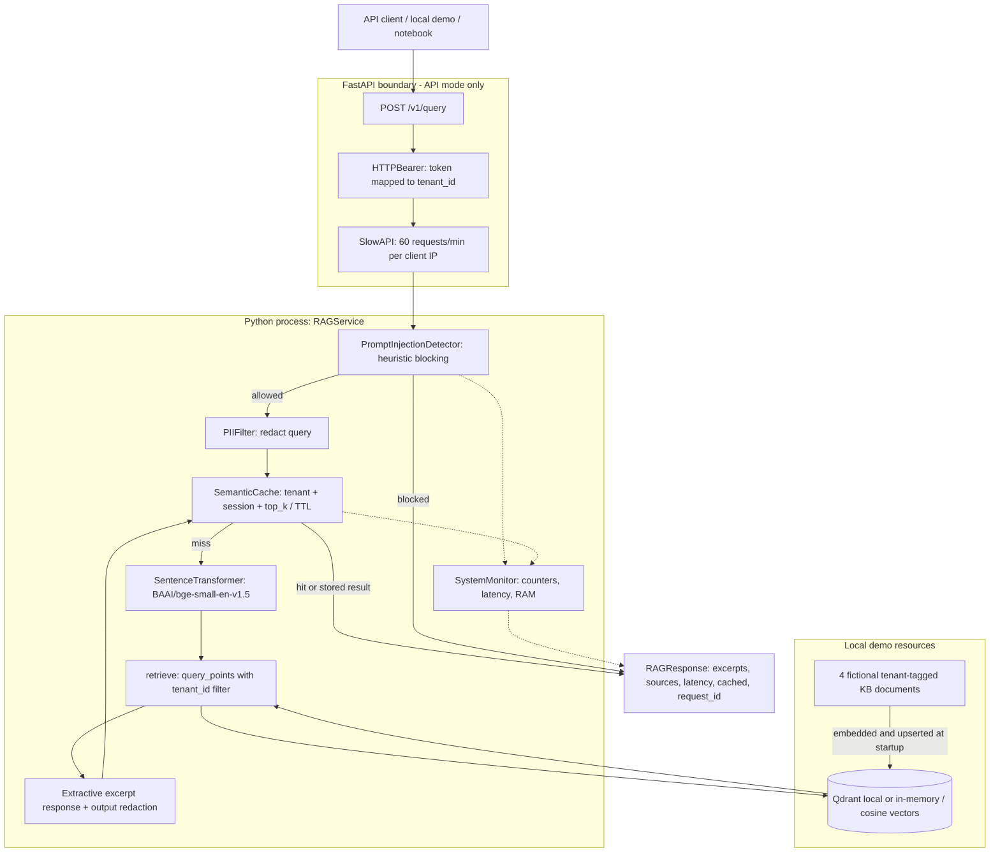
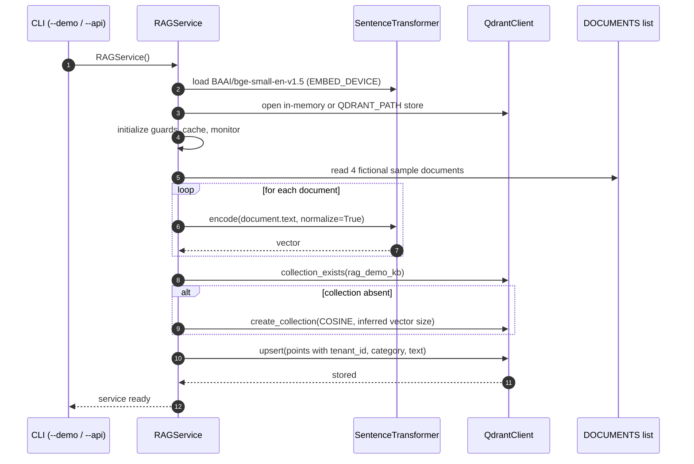

# System Architecture (High-Level Design)

## HLD: application and dependency boundaries

The application runs as **one local Python process**. A client can call `RAGService.handle` directly (CLI/notebook) or use the optional local FastAPI layer. Qdrant is constructed as either an in-memory instance or a local persisted store. `SemanticCache` and `SystemMonitor` reside in process memory.

### Diagram reading notes

- HTTP bearer authentication and IP rate limiting only exist for the **`--api`** path; the Python CLI invokes the service directly.
- API authentication derives `tenant_id` from the bearer key; the request body does not select a tenant.
- The embedding model is shared for all tenants; tenant isolation is implemented via **Qdrant payload filtering**, plus tenant-scoped cache keys.
- `--demo` initializes its own in-memory collection by default.
- Source KB content is fictional and inserted at application initialization, not via a file ingestion pipeline.

## Startup design: KB indexing

### Storage and indexing assumptions

- Collection name: `rag_demo_kb`.
- Distance metric: `COSINE`.
- Vector length is taken from the encoder's first output; there is no independent schema migration.
- Each Qdrant point has an integer `id` and payload fields `tenant_id`, `category`, and `text`.
- If an existing collection has a changed vector dimension or mismatched schema, the program does not include migration logic.

## Architectural quality attributes (what is demonstrated)

| Concern | Current implementation | Engineering implication |
|---|---|---|
| Security | Environment-token auth + regex guards | Demonstration only; not a production authorization solution |
| Isolation | Query payload filter and cache segmentation | Requires adversarial testing and defense in depth before deployment |
| Scalability | Single process, local model, local Qdrant | Model replication, concurrency and scaling are not implemented |
| Availability | Local service; no clustering | Restart loses in-memory cache and default vector store |
| Observability | In-memory counters, optional `psutil` | Not Prometheus/OpenTelemetry export |
| Privacy | Some regex masking | Original query echoed in output; sensitive metadata handling not complete |

## Deployment views

**Default:** client → `127.0.0.1:8000` → FastAPI + `RAGService` + model + in-memory Qdrant (single process). **Optional:** `QDRANT_PATH` persists local storage between restarts; it does not make Qdrant a network cluster. **Production target:** not provided by the uploaded source.

See [[Low-Level-Design]], [[Configuration-and-Operations]], [[Security-and-Limitations]].
